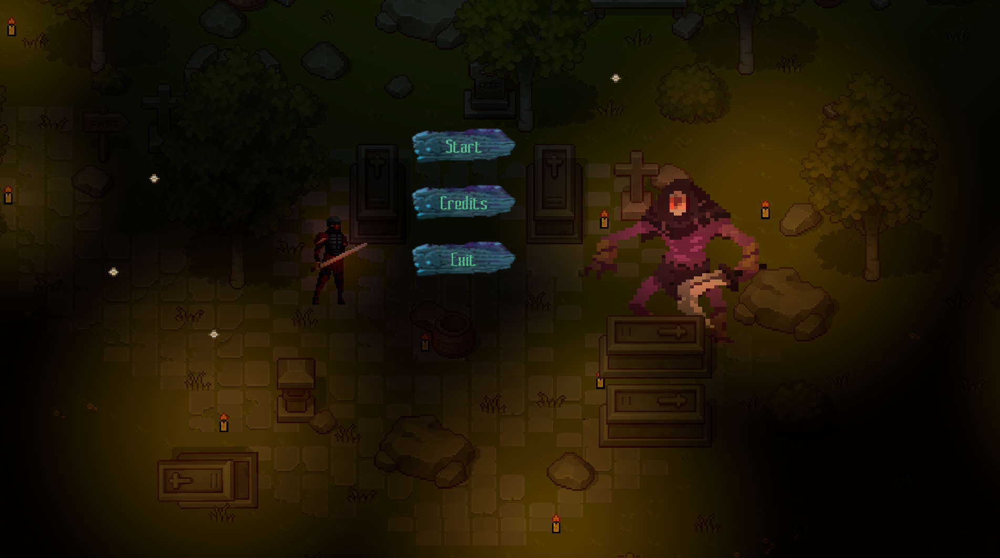
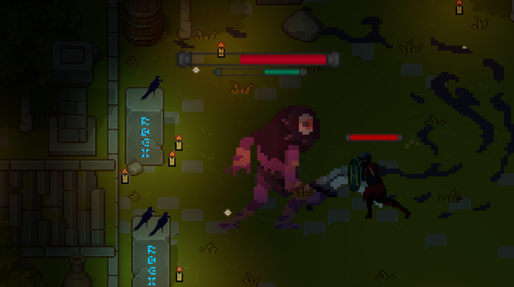
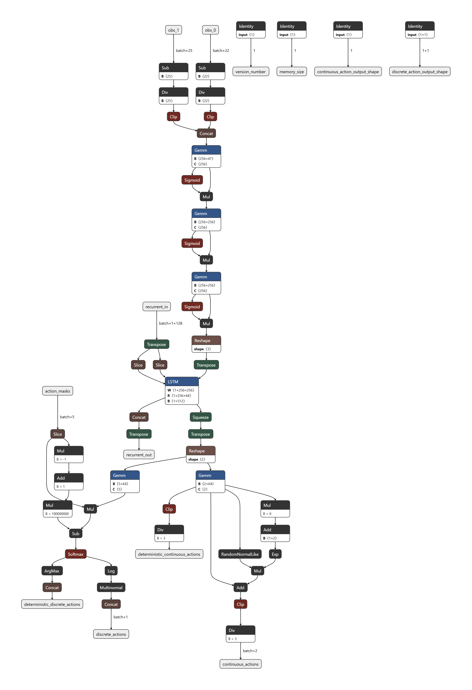

# Adaptive Boss-KI mit Unity ML-Agents

Im Rahmen meiner Bachelorarbeit wurde ein Spielprototyp entwickelt, in dem ein menschlicher Spieler als Boss gegen eine adaptive KI antritt. Die KI wurde mit dem Unity ML-Agents-Toolkit und dem Reinforcement-Learning-Algorithmus **Proximal Policy Optimization (PPO)** trainiert.
Steuerung

W, A, S, D – Bewegung
Linke Maustaste – Normal Attack
Rechte Maustaste – Second Attack
Leertaste – Strong Attack

## Screenshots

## Technologien
- Unity
- Unity ML-Agents
- Reinforcement Learning (PPO)
